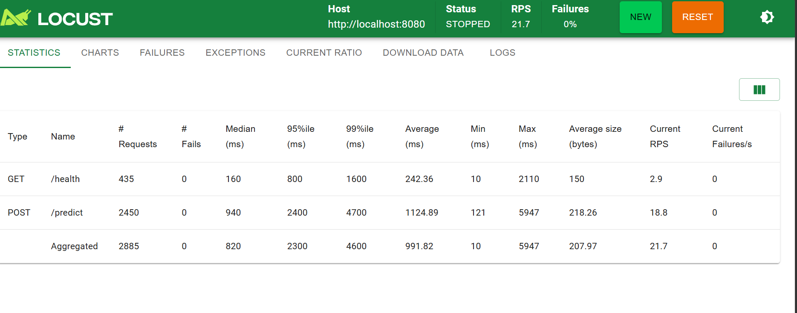

# Vehicle Damage Claim Triage

**Video demo (YouTube):** https://youtu.be/luJPTPC8gTs
**Live app (Azure):** https://ml-pipeline-summative.lemonrock-cdc9768c.southafricanorth.azurecontainerapps.io
**GitHub repo:** https://github.com/sahraomar1/ML_Pipeline_Summative

## What this project does

An insurance company gets many photos of damaged cars. This project trains a model that looks at one photo and says if the damage is **minor**, **moderate** or **severe**. Each level has a next step: minor claims are fast tracked, moderate claims go to an adjuster, and severe claims go to a senior adjuster.

The project covers the full cycle: data, cleaning, model, testing, retraining, API, web page, Docker, flood test and cloud deployment.

## Data

- **Source:** Car Damage Severity Dataset on Kaggle (license CC BY-NC-SA 4.0): https://www.kaggle.com/datasets/prajwalbhamere/car-damage-severity-dataset
- **Type:** car photos (images, not a table). The folder name is the label.
- **Size after cleaning:** 1,372 training photos and 248 test photos, in three balanced classes.
- **Cleaning:** all photos can be opened and are RGB. 11 identical duplicate photos were removed from the train folder, because 2 of them also existed in the test folder.
- **What the photos show:** brightness is almost the same in all classes. Edge strength (sharp lines) rises from minor (11.2) to severe (15.7), about 40% more. Moderate sits in the middle on every measure.

## Model and results

The model uses transfer learning with MobileNetV2 (ImageNet weights). It uses dropout, L2 regularization, the Adam optimizer, data augmentation and early stopping.

On the 248 test photos:

| Accuracy | Loss | Precision | Recall | F1 score |
|---|---|---|---|---|
| 0.6694 | 0.6782 | 0.6799 | 0.6694 | 0.6735 |

Moderate is the hardest class (F1 0.52). Minor and severe are rarely mixed (5 photos). Random guessing would give about 33%. The notebook has the full steps and the confusion matrix: `notebook/ML_Pipeline_Summative.ipynb`. The model file is `models/damage_model.h5`.

## How to set it up

Python 3.10 or newer is needed.

```bash
git clone https://github.com/sahraomar1/ML_Pipeline_Summative.git
cd ML_Pipeline_Summative
python -m venv .venv
.venv\Scripts\activate
pip install -r requirements.txt matplotlib seaborn jupyter locust kagglehub
```

- The photos are already in `data/`. To download them again: `python -m src.acquire_data`
- To train the model: open the notebook in VS Code and click **Run All**.
- To start the app: `uvicorn src.api:app --port 8000`, then open http://localhost:8000. The API test page is at `/docs`.

## How to use the web page

- **Predict:** choose one car photo and click **Predict**.
- **Data insights:** four charts of the training photos.
- **Upload and retrain:** choose photos of one damage level, pick the label, click **Upload images**, then click **Retrain model**. Use photos from `data/train` or new photos, not test photos.
- **Run evaluation:** tests the live model on the test photos.

## API endpoints

| Method | Path | What it does |
|---|---|---|
| GET | `/health` | Model status and up-time |
| POST | `/predict` | Predicts one photo |
| GET | `/insights` | Averages for the charts |
| POST | `/upload` | Saves many photos with a label |
| POST | `/retrain` | Starts retraining |
| GET | `/retrain/status` | Result of the last retraining |
| GET | `/evaluate` | Tests the live model on the test photos |

## How retraining works

Uploaded photos are saved on disk and recorded in a SQLite database (`data/app.db`). They get the same preprocessing as the training photos (RGB, 160 x 160). The saved model is then trained again for 5 epochs with a very small learning rate, and the new model replaces the old one. Retraining starts with the **Retrain model** button, or by itself when 50 new photos are waiting. Each run is recorded and can be seen at `/retrain/status`.

Retraining on only a few photos moves the model a little and can pull it toward one class. In a live test with 3 photos, accuracy went from 66.9% to 65.3%.

## Flood test (Locust)

50 fake users (5 new users per second, about 2 minutes) sent photos to `/predict`. Nginx shared the requests between the containers. All containers ran on one computer. Files and screenshots are in `results/`.

| Containers | Requests per second | Median (ms) | 95% (ms) | Failures |
|---|---|---|---|---|
| 1 | 17.7 | 1,400 | 1,900 | 0 |
| 2 | 19.9 | 1,000 | 2,400 | 0 |
| 3 | 20.3 | 940 | 2,400 | 0 |



Two containers gave a faster median and more requests per second than one. A third container added very little, because all containers share the same CPUs. An earlier 3-container run had 40 failed requests that did not repeat, so results change a little from run to run. The tests also showed a bug where the model loaded again for every request at start-up. It is fixed, and the model now loads once.

## Deployment

The app runs on **Azure Container Apps** (South Africa North, 1 CPU, 2 GB memory) from the Docker image `sahra1/ml-pipeline-summative:latest`. On the live app, **Run evaluation** takes about 6 seconds and matches the notebook (accuracy 0.6694).

The app was first deployed on the free Render plan. Everything worked except **Run evaluation**, which ran out of the 512 MB memory and restarted the service. That is why the app moved to Azure.

## Limits

- Uploaded photos and the database are lost when the app restarts.
- The first visit after a quiet period can be slow.
- Moderate damage is the hardest to find.